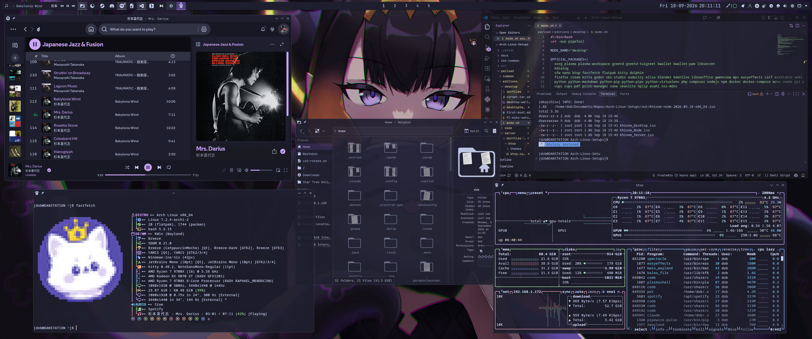
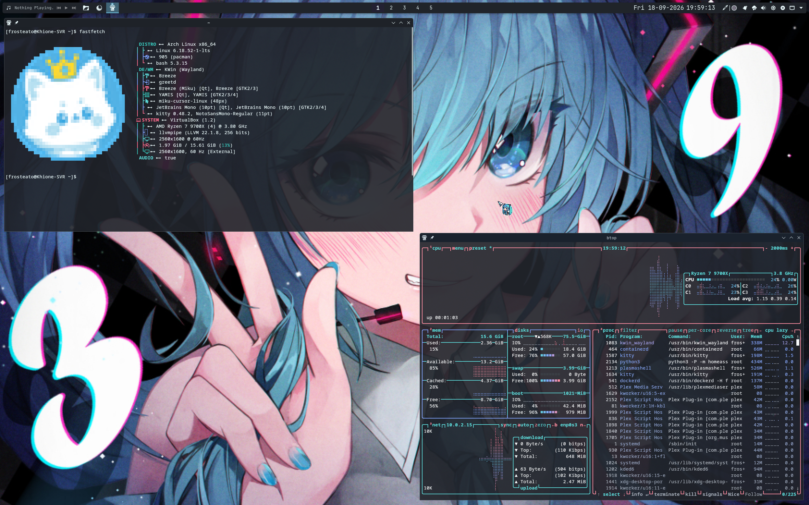
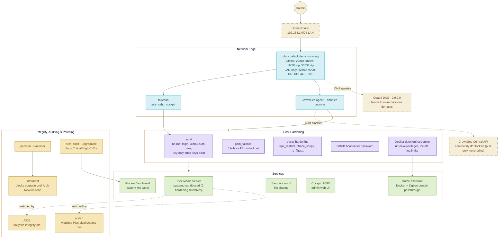
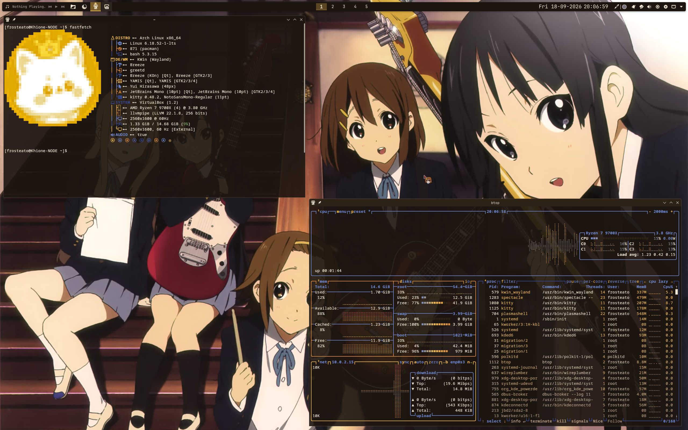
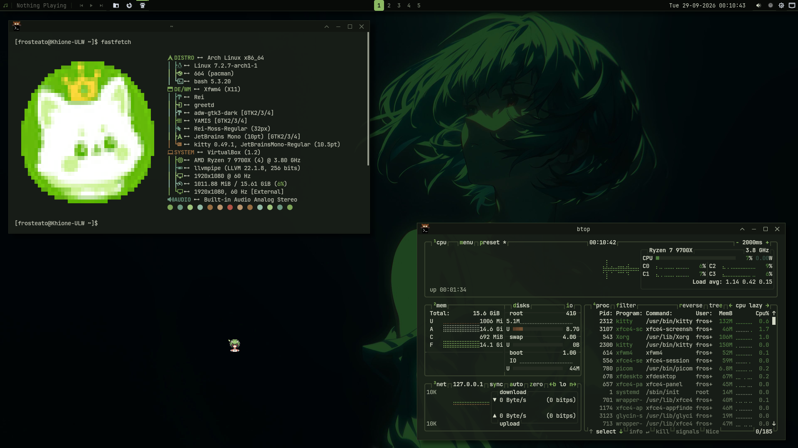

<p align="center">
  
</p>

Khione is an Arch-based Linux distribution built to get a fully configured machine running with as little manual setup as possible. It is written to my exacting specifications, and mirrors what I use on the day to day, so I can immediately set up a new device with almost zero effort.

There are four editions to choose:

- Desktop Edition
- Server Edition
- Node Edition
- Ultra-Lightweight Edition

---

<p align="center">
  
</p>

```
frosteato@khione-desktop ~ $ fastfetch

OS         Khione Desktop
Role       Gaming + dev + creative
DE         KDE Plasma
Terminal   kitty
Est. Size  ~5.4 GB
Packages   90 (pacman)
```
Khione Desktop is a full daily-driver environment with programming, productivity, gaming, and creative tools already installed.

Where it all began. After one too many rounds of distro-hopping and reinstalling everything from scratch, I scripted my way to a distro with EVERYTHING I need pre-installed - not a 'bloat is the enemy' minimal setup, though it's still light and efficient.

**Gaming**

Steam, Wine, and Proton pre-installed, AMD drivers ready to go. Nowadays, what more do you need?

**Development**

Python, PHP with Composer, Node.js with npm, Docker and Docker Compose, Git, and VS Code - ready from first boot, backed by make and cmake.

**Creative & Media**

Krita, Blender, Kdenlive, OBS Studio, Audacity, and Darktable cover illustration, 3D, video editing, streaming, and photo work.

**Music Production**

A dedicated setup script configures a Wine prefix specifically for FL Studio and Hatsune Miku V4X & Piapro Studio - sidestepping one of the most painful things to get working on Linux.

**Desktop Polish**

KDE Plasma, heavily customised with multiple themes and preset widgets, plus printing and scanning via CUPS and SANE, and Wacom tablet drivers out of the box.

<p align="center">
  
</p>

---

<p align="center">
  
</p>

```
frosteato@khione-server ~ $ fastfetch

OS         Khione Server
Role       Self-hosted services
DE         KDE Plasma
Terminal   kitty
Est. Size  ~1.9 GB
Packages   48 (pacman)
```

Khione Server is, as the name implies, a server-focused edition. It is a lean profile tuned for long-running services, including Plex defaults and enough local tooling to debug directly on the machine. Using Arch Linux as a server is somewhat unconventional, but if you know what you're doing, it works just fine.

**Media**

Plex Media Server is installed and enabled from first boot - point it at a library and it's straight into transcoding and streaming.

**File Sharing**

Samba handles file sharing, with wsdd making the server show up properly in Windows' Network browser. Cockpit adds a web GUI for shares, disks, and RAID arrays, with smartmontools watching disk health.

**Dashboard**

Glance runs on :8080 - weather, news, and server stats, plus meal-planning widgets, all driven by small systemd-timer scripts.

**Smart Home**

Home Assistant runs containerised on :8123 for smart-home control, with support for a Zigbee coordinator dongle. Its data lives outside the container, so it survives reinstalls.

**Remote Access**

Enough local tooling for hands-on debugging - terminal, file manager, text editor - plus SSH open for standard remote access, with ufw locked to only the ports each service actually needs.

**Security Hardening**

Server Edition opts into a full hardening pass: a default-deny firewall scoped to LAN where it can be, fail2ban and CrowdSec watching for abuse, file-integrity and audit monitoring, locked-down SSH/PAM/sysctl defaults, a hardened Docker daemon, a GRUB bootloader password, gated auto-updates that won't apply a security fix silently, and Quad9 DNS filtering for known-malicious domains. See the architecture diagram below for how it all fits together.

<br>

<p align="center">
  
</p>

<br>

<h3 align="center">Server Architecture Overview</h3>



> Not pictured: AppArmor was evaluated and deliberately left disabled - it broke boot on this specific GRUB + `linux-lts` setup, with no Secure Boot involved. The root cause wasn't pinned down, so it stays off rather than risk round two.

---

<p align="center">
  
</p>

```
frosteato@khione-node ~ $ fastfetch

OS         Khione Node
Role       Always-on kiosk
DE         KDE Plasma
Terminal   kitty
Est. Size  ~1.5 GB
Packages   35 (pacman)
```

Node is... minimal. Its entire job is to boot straight into a kiosk pointed at the Server's dashboard - and it shares the same ufw firewall baseline as the other editions. It's theme is pretty cute though.

**Boot Sequence**

Boots into a KDE Plasma session and opens Firefox straight to the Glance dashboard hosted by Khione Server - no manual steps.

**Always On**

Sleep, suspend, and hibernate are all disabled while plugged in, so it stays reachable as an always-on appliance.

<br>

<p align="center">
  
</p>

---

<p align="center">
  
</p>

```
frosteato@khione-ulw ~ $ fastfetch

OS         Khione ULW
Role       Ultra-Lightweight, build-it-yourself
DE         Xfce
Terminal   kitty
Est. Size  ~TBD
Packages   47 (pacman)
```

ULW means Ultra-Lightweight. It uses Xfce instead of KDE Plasma, and otherwise comes as a pretty much blank slate.  Just the bare essentials like a file manager and browser.

**Featherweight**

Xfce, picom, and a bare 47-package base add up to a system that idles at under 1GB of RAM - plenty of headroom, or great for older systems.

**Still the Khione Treatment**

ULW still has a colour coded theme made to look as close to the KDE - based flavours as can be, keeping it both distinct and familiar.

<p align="center">
  
</p>

---

<h2 align="center">Roadmap</h2>

- Nvidia support

---

<h2 align="center">Installation Guide</h2>

The Khione install flow is mostly automated, while keeping the key Archinstall choices in your hands.

## Before you begin

- Use a stable internet connection during install.
- Decide which ISO you want:
  - Desktop Edition: full daily-driver setup.
  - Server Edition: lightweight setup with server defaults.
  - Node Edition: minimal setup with just the base system and Firefox.
 
## Step 1: Download the ISO

Download the Desktop, Server, or Node ISO from the Releases page.

Optional but recommended checksum verification:

```bash
sha256sum <your-iso-file>.iso
```

## Step 2: Write the ISO to a USB

Use USBImager, Balena Etcher, or Rufus.

If you are on Linux and want to use `dd`:

```bash
sudo dd if=<your-iso-file>.iso of=/dev/<usb-device> bs=4M status=progress oflag=sync
```

## Step 3: Boot from the USB

- Boot the target machine from the USB.
- Select the Khione install option in the boot menu.
- The installer launcher should auto-start on tty1.

If it does not auto-start, run it manually:

```bash
/root/start-install.sh
```

## Step 4: Complete Archinstall base configuration

In Archinstall, configure the basics:

- Mirror region
- Disk layout and mount points
- User account(s) and passwords
- Timezone and locale

Then let Archinstall complete the base system installation.

## Step 5: Let Khione finish setup

After Archinstall finishes, Khione continues automatically and applies packages, services, and system configuration.

Install output is logged to:

```bash
/var/log/khione/install-<timestamp>.log
```

## Step 6: Reboot into Khione

Once setup fully completes:

- Reboot
- Remove the USB when prompted
- Log into your new system

## Step 7: Quick post-install checks

- Confirm networking is up
- Run updates

```bash
yay
```

For troubleshooting logs:

```bash
cat /var/log/archinstall/install.log
ls -1 /var/log/khione/
```

## Step 8: Success!

Khione is now installed and ready to use, tweak, and build on.

---

<h2 align="center">Music Production Support</h2>

Linux and music production have historically not gotten along, especially in the PulseAudio days. DAW support isn't great and wine tends to fight back. Khione includes a dedicated setup script that handles the fiddly bits for you.

## FL Studio + Hatsune Miku

`fl-miku-setup` creates a dedicated Wine prefix pre-configured for FL Studio and the Crypton Piapro Studio voicebank suite, including Japanese locale and font setup so the installers actually render correctly.

**Supported:**
- FL Studio 25
- Piapro Studio VST
- Hatsune Miku V4X voicebank
- Hatsune Miku V4 English voicebank

> **Note:** Hatsune Miku V6 / Vocaloid 6 is currently broken on Linux under Wine and, whilst optionally included, will not properly work.

## Setup

Download your installers and put them in the right place:

- The script will download FL Studio automatically.
- Place your SonicWire Miku V4X zip anywhere inside `~/Installers/Audio/MikuV4X/`.

Then search for `FL Miku Setup` in KRunner, or run it from a terminal:

```bash
fl-miku-setup
```

It will walk you through everything interactively. You can re-run it at any time to install individual components, regenerate launchers, or activate voicebank licences.

## After setup

The following entries will appear in KRunner:

- `FL Studio` — launch the DAW
- `FL Miku Wine Config` — open winecfg for the fl-miku prefix
- `Kill FL Miku Wine` — stop the Wine server

---

<h2 align="center">FAQ</h2>


## Why not use a headless server?

- No modern hardware has a meaningful loss from having something like plasma running in the background
  - Miku :)
- Sometimes it's easier to debug on-device and this is running on a spare laptop
  - Miku :D
- I can still SSH in
  - Miku :3
- I wanted an excuse to rice Arch again
  - Miku :0
- I have a staggering skill issue

## How do I use my programs?

Pressing alt + space will open KRunner, which you can use to type in any program name or category and it will appear.

## How do I update my programs?

Just type yay into the terminal, it will find and update everything for you. Very handy.

## How do I get new programs?

Google "*program you need or problem to solve* Arch" and and it will probably appear. If it's part of the main Arch repos you can do 

```
sudo pacman -S *packageName*
```
and if it's part of the AUR you can do
```
yay -S *packageName*
```
to install it.

---

<h2 align="center">Credit where credit is due</h2>

## Arch Linux

Obviously, this is built on top of Arch Linux. Thank you for every maintainer for their hard work!

`https://archlinux.org/`

## Archinstall

My scripts and changes are stapled onto & around Archinstall. Without their incredible work this wouldn't be possible. Thanks!

`https://archinstall.archlinux.page/`

## Wallpapers

- Ina: https://www.pixiv.net/en/artworks/103938068
- Miku: https://www.pixiv.net/en/artworks/73597952
- K-On!: https://www.kyotoanimation.co.jp/en/ Promo Image
- Rei: https://steamcommunity.com/sharedfiles/filedetails/?id=3305590289 (modified)

---

<h2 align="center">AI Usage Disclaimer</h2>

Generative AI may or may not be used for the creation of this project. All releases are still also manually tested.
